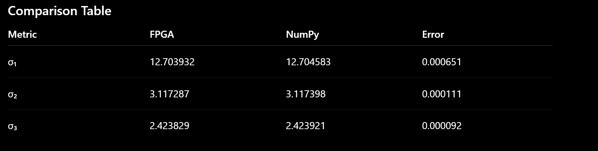
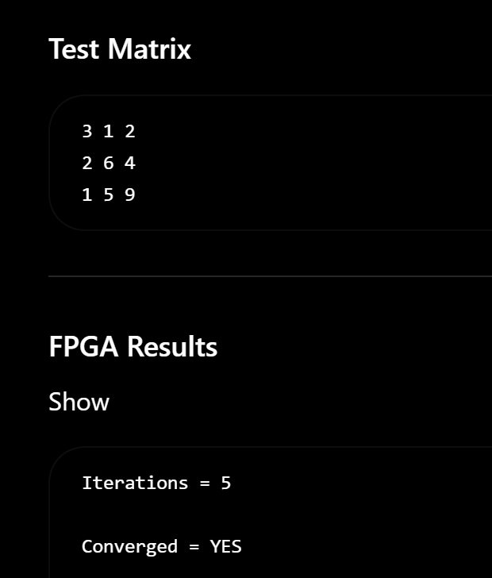

# FPGA-Based Jacobi SVD Accelerator

A fixed-point, cyclic/greedy one-sided Jacobi Singular Value Decomposition
(SVD) engine implemented in SystemVerilog, originally built to compute
deformable-mirror actuator voltages in real time for an adaptive optics
system.

Currently implemented and verified for **3x3 matrices**.

---

## Why Jacobi SVD on an FPGA?

Adaptive optics control loops need to invert (or pseudo-invert) a poorly
conditioned interaction matrix at kilohertz rates to compute deformable
mirror actuator commands. The one-sided Jacobi method converges reliably
even on near-rank-deficient matrices and — unlike QR/Golub-Kahan based
SVD — decomposes naturally into a sequence of small, independent 2-column
rotations, which map well onto FPGA pipelines.

---

## Architecture

```
                 ┌────────────────────┐
   matrix_in ─── │   matrix_bank_3x3  │── column writes
                 │  (holds current A) │
                 └─────────┬──────────┘
                           │ col_i, col_j
                           ▼
                 ┌────────────────────┐
                 │   jacobi_params    │  computes alpha, beta, gamma
                 └─────────┬──────────┘  (dot products of column pair)
                           ▼
                 ┌────────────────────┐
                 │  jacobi_rotation   │  CORDIC-based angle + c,s
                 └─────────┬──────────┘
                           ▼
                 ┌────────────────────┐
                 │  column_rotator    │  applies [c -s; s c] to the pair
                 └─────────┬──────────┘
                    │              │
                    ▼              ▼
         matrix_bank_3x3      v_bank_3x3
         (write rotated A)   (accumulate V = V·J)
                           ▲
                           │
                 ┌────────────────────┐
                 │  jacobi_sweep_ctrl │  start/done handshake,
                 │                    │  greedy pair selection,
                 └────────────────────┘  convergence check
```

**Top-level module:** [`jacobi_svd_3x3`](rtl/jacobi_svd_3x3.sv)

```systemverilog
module jacobi_svd_3x3 #(
    parameter MAX_ROTATIONS = 108,  // ~12 sweeps
    parameter CONV_SHIFT    = 18    // relative convergence threshold
)(
    input  logic clk,
    input  logic rst,
    input  logic signed [31:0] matrix_in  [0:2][0:2],
    output logic signed [31:0] matrix_out [0:2][0:2],  // A*V = U*Sigma
    output logic signed [31:0] V_out      [0:2][0:2],  // right singular vectors
    output logic svd_done
);
```

### Module breakdown

| Module | File | Role |
|---|---|---|
| `jacobi_svd_3x3` | `rtl/jacobi_svd_3x3.sv` | Top level; orchestrates the sweep, greedy pair selection across all 3 off-diagonal pairs, and exposes `matrix_out` / `V_out` |
| `jacobi_params` | `rtl/jacobi_params.sv` | Computes `alpha`, `beta`, `gamma` (dot products of the selected column pair) that drive the rotation angle |
| `jacobi_rotation` | `rtl/jacobi_rotation.sv` | CORDIC-based rotation engine; converts `alpha/beta/gamma` into cosine/sine and rotates the column pair |
| `column_rotator` | `rtl/column_rotator.sv` | Applies a `[c -s; s c]` rotation to a pair of columns given `c`, `s` |
| `matrix_bank_3x3` | `rtl/matrix_bank_3x3.sv` | Register bank holding the working copy of `A`; supports column read/write by index |
| `v_bank_3x3` | `rtl/v_bank_3x3.sv` | Register bank holding `V`, accumulated as `V <- V*J` for every rotation `J` applied to `A` |
| `jacobi_sweep_controller` | `rtl/jacobi_sweep_controller.sv` | Start/done handshake and convergence/iteration-limit stop condition |

### Key design points
- **Greedy pair selection** — instead of fixed cyclic ordering (0,1) → (0,2) → (1,2), the top level computes all three `gamma` values each round and rotates the pair with the largest `|gamma|` first. This converges roughly 2x faster than naive cyclic ordering on ill-conditioned matrices, since a fixed order otherwise keeps re-visiting the same still-large pair after wasting rotations on already-small ones.
- **V-matrix tracking** — `v_bank_3x3` accumulates the right singular vectors by applying the identical rotation to V's columns that was just applied to A's columns.
- **Fixed-point (Q16.16)** arithmetic throughout, with a relative convergence threshold (`CONV_SHIFT`) rather than an absolute one, to avoid pseudoinverse blow-up on near-rank-deficient matrices.

---

## Verification

Each module has a standalone testbench in [`/tb`](tb):

| Testbench | Verifies |
|---|---|
| `tb_jacobi_params.sv` | alpha/beta/gamma computation |
| `tb_jacobi_rotation.sv` | CORDIC rotation angle + column rotation |
| `tb_column_rotator.sv` | rotation matrix application |
| `tb_matrix_bank_3x3.sv` | column read/write register bank behavior |
| `tb_jacobi_sweep_controller.sv` | start/done handshake and stop conditions |
| `tb_jacobi_svd_3x3.sv` | full top-level convergence on the test matrix below |

### Golden-model validation

FPGA output is cross-checked against NumPy's `np.linalg.svd` (see
[`scripts/numpy_reference.py`](scripts/numpy_reference.py)) on the same
test matrix:

```
3  1  2
2  6  4
1  5  9
```

**FPGA run:** `Iterations = 5`, `Converged = YES`

| Metric | FPGA | NumPy | \|Error\| |
|---|---|---|---|
| σ₁ | 12.703932 | 12.704583 | 0.000651 |
| σ₂ | 3.117287 | 3.117398 | 0.000111 |
| σ₃ | 2.423829 | 2.423921 | 0.000092 |

Errors are within expected Q16.16 fixed-point quantization tolerance.
Full run log: [`results/fpga_run_log.txt`](results/fpga_run_log.txt) ·
Raw comparison: [`results/comparison_table.csv`](results/comparison_table.csv)

<p align="center">
  
  <br>
  
</p>

---

## How to run

**Simulation (any SystemVerilog simulator, e.g. Xilinx Vivado / Xcelium):**

1. Add all files in `rtl/` to your simulation project.
2. Add `tb/tb_jacobi_svd_3x3.sv` as the top-level testbench for the full
   decomposition, or any individual `tb_*.sv` file to test a module in
   isolation.
3. Run simulation; `tb_jacobi_svd_3x3.sv` drives the 3x3 test matrix above,
   waits for `svd_done`, and prints `matrix_out` / `V_out`.

**Golden-model comparison:**

```bash
cd scripts
python3 numpy_reference.py
```

Compare the printed `Sigma` values against the FPGA's `matrix_out`
diagonal (after `svd_done`).

---

## Tools

SystemVerilog · Xilinx Vivado · Artix-7 (Basys 3) · Python / NumPy (golden
model)

## Author

Sean Gabriel — B.Tech Electronics Engineering (VLSI Design & Technology),
Manipal Institute of Technology
[LinkedIn](https://linkedin.com/in/sean-gabriel-409873312) ·
[GitHub](https://github.com/Sean184344)
